# Consolidação WappHub — diagnóstico A0/A1

Data: 2026-10-11 UTC. Executor: Codex no homelab. Escopo: auditoria e proposta; nenhuma mudança funcional, deploy, pareamento, envio ou solicitação histórica provocada pelo executor.

Fonte canônica de andamento: [PROGRESS](WHATSAPP_WEB_CONSOLIDATION_PROGRESS.md). Proposta revisável: [PROPOSAL](WHATSAPP_WEB_CONSOLIDATION_PROPOSAL.md). Contrato de execução: [EXECUTION](WHATSAPP_WEB_CONSOLIDATION_EXECUTION.md).

## 1. Baseline verificado antes das alterações documentais

| Componente | Checkout original, limpo | Main remota consultada | Publicação Docker, revision conferida |
| --- | --- | --- | --- |
| Core/API/Worker | `apps/wapphub-core`, main `db85dace50cc622776afcfb2ce9512151c96d857` | `766ff09201e1e6b4fba1008db28fe47345cd5226` | `wapphub-core:cp47-bb356c7`, revision `bb356c7093e231ce86b9e818ffdeb5ef96188639` |
| Provider | `wapphub-core/services/wapphub-provider-web`; mesmo Git do Core | PR23 incorporada; não publicada | `wapphub-provider-web:cp47-bb356c7`, mesma revision |
| Chat | `apps/wapphub-chat`, main `f13752f505feeef90183a4f4d075907ed84b0ac0` | `34acd1fd212663b1685b45517e8a7fb548ddb871`, somente AGENTS diferente | `wapphub-chat:cp47-6cd6898`, revision `6cd6898e7ef0bc9257b70c6b8cc5063e2bf49da8` |

Os documentos obrigatórios estavam somente na main remota. `git ls-remote`, `git fetch origin main`, `git log HEAD..origin/main` e `git diff --stat HEAD origin/main` confirmaram a diferença. Os checkouts operacionais não foram atualizados nem descartados. Worktree documental: `/home/uillan/homelab/apps/wapphub-core-consolidation-audit`, branch `docs/consolidation-a0-a2-20261011`, base `766ff09`.

PRs verificadas pela API GitHub:

- [Core PR23](https://github.com/uillaneduardo/wapphub-core/pull/23): merge `3285a46`, captura nativa/retry local de referência retida, ainda ausentes da imagem em execução.
- [Core PR24](https://github.com/uillaneduardo/wapphub-core/pull/24): merge `766ff09`, normas e progresso de consolidação.
- [Chat PR18](https://github.com/uillaneduardo/wapphub-chat/pull/18): merge `34acd1f`, normas documentais.

Legados separados: `apps/wapphub` main `600bccca19265a64781030267da101d4894fdea3`, `apps/chat` main `84b5180e832312e6a650cdda7be4f317073440c8`, ambos limpos. Container legado `wapphub` e bancos legados continuam existentes; não são Core/Chat atuais. Platform não localizado nos repositórios reais do homelab; seu AGENTS não estava disponível. Não se utilizou o projeto `nfc-inspector-platform` como substituto.

AGENTS lidos: Core local e remoto, Provider remoto, Chat local e remoto e legado `chat`. Core exige arquitetura/domínio/segurança/contratos e os documentos mandatórios de README/AGENTS; Chat exige SCOPE/ROUTES/UX_REALTIME/DESIGN_SYSTEM/MEDIA_EXPERIENCE/STATUS. Consultados também CP4/CP4.6/CP4.7, native bootstrap, contratos, schema, código e relatório CP4.6/relatórios CP4.7. STATUS e textos M0/M1 contêm registros históricos; não foram tratados como inventário de produção.

### Produção observada

Evidências locais sanitizadas: `~/homelab/deploy-records/wapphub-provider-web/20261011-consolidation-a0-a2/`.

- Seis serviços Core/API/Worker, Provider, Chat, MariaDB e Redis `healthy`; Core/Source `CONNECTED`, socket ativo, prontidão verdadeira; backlog observado zero.
- Serviços app iniciados às 10:23–10:24 UTC, sem reinício nesta execução. Compose do Core: `compose.yml` + `compose.provider-web.yml`; Provider: `services/.../compose.yml` + `compose.chat-integration.yml` + overlay privado `20261010-checkpoint4-fix/provider-linked-recovery.yml`; Chat: seu `compose.yml`.
- Runtime Provider Node `v22.23.3`, Baileys `7.0.0-rc14`; Node local de testes `v22.22.1`. Package e lockfile fixam RC14; Core não importa Baileys.
- Flags efetivas: Core/Worker execução histórica `true`; Provider sync `true`, execução `true`, autorização por conexão `true`, história legada `false`, linked-recovery-only `true`. `PROVIDER_INITIAL_HISTORY_ENABLED` não existe na imagem atual; estará no código remoto, não nesta publicação.
- Grant existente `ENABLED`, autorizado às 13:47:14 UTC antes desta auditoria; piloto 20 mensagens/30 dias/16 solicitações. Source `PAUSED/HISTORY_BYTE_LIMIT`, duas falhas da operação, uma solicitação remota, referência criptografada retida, sem `requestAt` pendente e zero mensagens históricas no Core. Não atribuímos ao agente a autorização ou solicitação preexistente.
- Mais de 1.200 `history_reconcile COMPLETED` são comandos internos; não são requisições de histórico ao WhatsApp. Código publicado não retoma automaticamente decode com falhas; o coordenador continua renovando autorização de uma operação parada.
- Sessão única, identidade vinculada presente, QR revision 3, `desired=true`, tentativas persistidas 5. O próximo `start` incrementa para 6 e falha com `RECONNECT_LIMIT`; risco concreto para próximo reinício, sem tentativa realizada aqui.
- 14 falhas legadas permanecem separadas, sem causa reconstruível. Novas falhas de normalização e persistência no snapshot: zero. Censo inicial: 63 mensagens existentes, 19 contatos scoped, 6 conversas; não são mensagens recuperadas nesta auditoria.
- Demo `DISABLED` em produção, mantido; regressão funcional exercitada somente isoladamente.
- HTTP público API health e rota Chat providers: 200, via curl sem autenticação e sem conteúdo pessoal. Isso comprova disponibilidade HTTP, não homologação de atendimento.
- Recursos iniciais: aproximadamente 3,9 GiB disponíveis, 2,1 GiB de swap ocupados, 14 GiB de disco livres. Provider limitado a 512 MiB/1 CPU/128 PIDs; `/tmp` tmpfs16 MiB. Não constitui benchmark de capacidade comercial.

Backups CP4.7 e evidências de restauração já existentes foram consultados; não houve novo backup/restauração nesta auditoria. SQL `backups/wapphub-core/wapphub-core-pre-cp47-20261011-101504.sql.gz`; sessão `backups/wapphub-provider-web/pre-cp47-20261011-101519/sessions.tar.gz`. Imagens anteriores preservadas conforme inventário CP4.7. Nenhum snapshot Signal foi restaurado.

## 2. Arquitetura e caminhos efetivamente conectados

```mermaid
flowchart LR
  WA[WhatsApp] --> SDK[Baileys RC14 no Provider]
  SDK --> N[Normalização e Sessions]
  N --> V[Vault criptografado e journal existente]
  V --> W[Core Worker pull e lease]
  W --> I[WebIngestion e WebSync]
  I --> DB[MariaDB domínio Inbox checkpoint e stream]
  DB --> RT[Realtime autorizado Redis sinal e replay SQL]
  RT --> C[Chat Inbox e histórico paginado]
  C --> API[Core sessão Membership RBAC Origin CSRF]
  API --> ADM[ProviderCommand administrativo e histórico]
  ADM --> W
  W --> V
  C -. envio Web ainda bloqueado .-> API
```

O Provider é adaptador isolado por necessidade de sessão/SDK. Core é monólito modular com processos API/Worker, única persistência de negócio. Redis notifica o stream durável SQL; não contém o histórico canônico. Não existe Outbox separado para mensagens Web: o outbox existente é `ProviderCommand`, usado por lifecycle/histórico. Não há object storage/Media implementado no Core atual.

## 3. Inventário de funções, eventos, persistência e cobertura

Referências abaixo usam a base auditada `766ff09`; caminhos Chat usam código funcional `f13752f`, idêntico ao remoto exceto AGENTS. Linhas completas em `source-inventory.txt`. Arquivos SDK abaixo pertencem ao pacote instalado em `apps/wapphub-core/services/wapphub-provider-web/node_modules/baileys/lib`; não são código próprio.

| Fluxo | Função/arquivo e linha | Persistência/estado | Cobertura e conclusão |
| --- | --- | --- | --- |
| QR/autenticação | Provider `baileys.ts:16` encryptedAuth, `:56` factory; `sessions.ts:57` command, `:153` start e connection | AES-GCM Vault, Signal keys, geração de ator, QR em memória temporária | sessions.test: QR/refresh/deadline/revogação; sem QR real nesta execução |
| Reconexão | `sessions.ts:153–245` start/connection/recover | desired, attempts; cinco total, três por processo em modo vinculado | testes de códigos401/403/411/440/500 e fencing; contador lifetime não reabilita após sucesso |
| Bootstrap inicial | `baileys.ts:67–81`, `:153` drainBootstrap, `:192` messages.upsert; `sessions.ts:28` historyEnabled | PR23: historyImports.pending/digest/initialPending/downloads/decodedBytes no Vault | sync.test: QR inicial, conta já vinculada, decoder limitado; não publicado nem comprovado remotamente |
| Contatos/conversas | `baileys.ts:128–132`; `sync-normalization.ts:23–46`; Core `web-sync.ts:99–139` | ContactIdentity org/channel/alias, Contact, Conversation.providerMetadata | PN/LID, nomes manuais, metadados, conflitos e conversas sem mensagens testados |
| Live/celular | `baileys.ts:192–259` notify/append; `events.ts:36` stage; Core `web-sync.ts:53` apply | sync.batch, Message/provider ID/direção/data original | CP4 homologado; testes sintéticos live/journal/SQL/realtime. Celular OUTBOUND DEVICE, sem atendente inventado |
| História SDK | `baileys.ts:133` processHistory, `:147–149` history handlers; SDK chats.js:917–970 | leitor SDK automático bloqueado; adaptador recebe notificações self-only | shouldSyncHistoryMessage=false intencional; `messages.upsert` vem antes do filtro no SDK |
| ON_DEMAND | `baileys.ts:86–97`, `:199–207`; `history-operation.ts:20,56,79,128`; SDK messages-recv.js:40 | historyOperation, requestAt antes da rede, requestId, reference/spool/cursor | correlação peerDataRequestSessionId/self-only/ON_DEMAND; request ID não significa importação; vazios/timeouts/incertos testados |
| Worker/retomada | Core `web-provider-worker.ts:22,135,177`; `web-history.ts:20,51` e historyGrantValid | ProviderCommand payload, autorização durável, lease60s, checkpoints/manifest | regressão banco isolado + journal real sintético, revogação/CSRF/tenant/sem browser |
| Destinatário existente/novo | Core `chat.ts:512`; Chat `NewConversation.tsx:12–45`; SDK socket.js:222 onWhatsApp | hoje criação somente interna channelId=null; não existe resolução WhatsApp | contatos/criação interna testados; consulta SDK PN disponível, LID não aceito por onWhatsApp; API WappHub ausente |
| Envio texto | Core `chat.ts:743–820`, `messaging-provider.ts:11`, `demo-provider.ts:9`; Provider `transport.ts:15` | Demo em processo, IDs determinísticos; Web bloqueado; sem dispatch remoto | Web rejeita PROVIDER_SEND_UNAVAILABLE; SDK messages-send.js:1053 sendMessage disponível, não chamado pelo WappHub |
| Recibos | `baileys.ts:260–267`; Core `web-ingestion.ts:58–89`, `web-sync.ts:34–49`; SDK messages-recv.js:1189–1199 | journal message.updated, monotonicidade e pendingReceipts256/7dias | recibo antes da mensagem e replay testados; SERVER_ACK→SENT, DELIVERY_ACK→DELIVERED, READ/PLAYED→READ |
| Receipts manuais | Core `chat.ts:830–860` messageStatus | comando interno de leitura | bloqueia mensagens externas EXTERNAL_RECEIPT_UNSUPPORTED; manter ao adicionar envio Web |
| Imagem/áudio/voz/vídeo/documento recebidos | `sync-normalization.ts:48–68`; Core `message-ingestion.ts:6`; Chat `Conversations.tsx:201` | mediaMetadata PENDING, legenda/MIME/tamanho/hash/mediaId, sem material criptográfico | somente metadados testados; binários não preservados nem baixados; não há player/upload |
| Upload/download SDK | SDK messages-send.js:1011/1053; Utils/messages.js:137–199/833; messages-media.js:309/416/643 | SDK encrypt/decrypt stream e upload, arquivos temporários, media retry remoto | APIs presentes; nenhum caminho WappHub para utilizá-las; disponibilidade/expiração real não testada |
| Arquivamento | `normalizeConversation:38`, Core `web-sync.ts:130`, `chat.ts:540` archive | remoto em providerMetadata, interno status/archivedAt | preservação de estado interno testada; atualização remota esparsa pode perder campos anteriores |
| Inbox/realtime | Chat `InboxList.tsx:47–83`, `Conversations.tsx:113–149`, `useMessageScroll.ts:64` | caches scoped, cursor, replay, anchor de leitura | 287 testes Chat/30 arquivos, jsdom; `contacts.updated` ainda refresca página inteira da Inbox |

### SDK presente versus produto disponível

`onWhatsApp` constrói USyncQuery/withContactProtocol e consulta PN; rejeita LID e pode retornar ausência/undefined. Normalizar formato não comprova cadastro WhatsApp. `fetchMessageHistory` envia pedido peer-data com chatJid/oldestMsgId/fromMe/timestampMS; exige identidade vinculada. Nenhuma dessas APIs enumera todo histórico remoto.

`sendMessage` prepara texto/imagem/áudio/vídeo e upload. Retorno e ACK servidor não provam entrega/leitura. `downloadMediaMessage(..., 'stream', ...)` evita agregação em Buffer, mas reuploadRequest/updateMediaMessage é uma operação remota adicional, não leitura puramente local. `encryptedStream` cria arquivo criptografado em tmpdir e pode criar original para thumbnail/duração; bounds precisam existir também em streams locais. No trecho de download analisado, `downloadEncryptedContent` usa cipherKey/IV e não faz comparação automática com fileSha256 do conteúdo: a aplicação precisa definir verificação antes de servir cache completo.

SDK usa makeEventBuffer e estados próprios de app-state/offline. Não é um banco completo de mensagens para o Core. Configurar callback getMessage para recuperar mensagens WappHub autorizadas no adaptador será necessário para retries de protocolo de saída; só versão mínima criptografada de conteúdo enviado pode permanecer no vault, com retenção e escopo. Não utilizar resyncAppState como importador.

## 4. Achados e oportunidades concretas

| ID | Evidência | Impacto | Correção mínima proposta |
| --- | --- | --- | --- |
| A01 — transição bootstrap | nativeBootstrap constante `baileys.ts:68`; append em `:239`; Sessions gate dinâmico `:28` | PR23 perde append recente após initialPending=false; notify preservado | predicado dinâmico compartilhado de captura; append recente usa live após término; teste entre camadas |
| A02 — testes temporais | spec nos testes auto-history:10/history-operation:19 usa dois Date.now; schema history.ts:7 exige ≤30dias | 1ms torna fixture inválida, falhas intermitentes e main CI vermelho | um epoch por fixture/operação; preservar schema estrito e testar fronteiras |
| A03 — reconciliação sem progresso | Worker coordinate `:152–171`; publicado importer reconcile aceita falhas somente zero | mais de1200 comandos internos/audit/version/fsync, sem novas mensagens | renovar lease15s apenas produtor ativo; pausas têm nextEligibleAt/razão, reavaliação lenta ou intervenção; retry local de referência limitado |
| A04 — orçamento de sessão | Sessions start `:163–172`; open `:213–221` não separa sucessos/falhas | sessão saudável attempts5 impede próximo restart | separar tentativas históricas de falhas consecutivas/episódio; manter limites, revogação e QR bloqueados; nunca resetar vault à mão |
| A05 — limite total disfarçado de lote | events.ts:57–64, history-selection.ts:34–49, baileys.ts:225–231 | 500/500/1000 e16/32MiB são totais de admissão/ciclo; cortes de protobuf não informam limited ao chamador | budget separado de batch, cursor por referência entregue, diagnóstico explícito de truncamento/sem fonte disponível |
| A06 — bootstrap incompleto | drainBootstrap `:178–187` break após falha; inicial fecha só RECENT100; boundHistoryObjects reduz campos antes de decode | referência pode esperar nova notificação/restart; outros finais não provam término; não pode declarar completo | agenda durável no Worker existente + controle source/local-retry; encerramento explícito/parcial por orçamento/inatividade, sem nova fetch |
| A07 — identidade repetida | WebIngestion `:35–50` cria contato primaryIdentifier=JID; WebSync `:99–139` usa web:channel:JID e aliases/prefetch | regras divergentes/mais código e risco de duplicação na evolução outbound | um resolvedor Core com prova PN/LID; adaptar evento clássico para item canônico, manter receipts separados |
| A08 — persistência repetida | MessageIngestion.persistExternal:6 e persistInbound:25 | ambos criam Message e atualizam lastMessageAt com políticas diferentes | compartilhar gravação básica parametrizada, preservando datas/status e Demo; não unir lifecycle de autenticação com grants |
| A09 — metadados esparsos | WebSync `:130–134` substitui JSON providerMetadata | unreadCount sozinho pode apagar archived remoto conhecido | patch de campos presentes + observedAt por campo; nunca alterar status interno |
| A10 — saída ausente | Chat send bloqueia Web; WebProviderPort/HTTP/Transport não têm send/resolve | atendimento Web unidirecional no Chat; nenhuma conversa externa manual | estender port/contrato existente, ProviderCommand/Worker e Message; não criar fila paralela |
| A11 — capabilities imprecisas | events.ts:8–9, Chat DTO outboundEnabled/providerCatalog | contentTypes mistura capacidade de metadata e transporte; booleano Web hardcoded | projeção Core por ação/direção/conteúdo/saúde; registry pequeno Demo/Web, Meta indisponível |
| A12 — mídia não recuperável localmente | sync-normalization.ts:64 descarta directPath/mediaKey; Core não possui Media | mediaId PENDING não permite download posterior; mensagens antigas sem referência não podem ser reconstruídas | referência mínima privada criptografada Provider + metadata Media scoped Core; conteúdo sob demanda |
| A13 — limite de tmp incompatível | Compose `/tmp:size=16m`; SDK encryptedStream cria arquivo criptografado e eventualmente original | mídia até25MiB do contrato não cabe no runtime, até50MiB temporários por upload | scratch privado limitado, criptografado/quota/cleanup; fornecer metadata validada e evitar original SDK quando possível |
| A14 — erro incerto tratado como failed | Chat Conversations:170 catch genérico→FAILED/retry | timeout poderá induzir reenvio cego quando Web estiver disponível | separar deliveryOutcome UNKNOWN/NOT_SENT de status; reconciliar intenção persistida antes de retry |
| A15 — eventos repetidos/invalidação | Core resource events e Chat InboxList:69/75 | contacts.updated descarta páginas carregadas; mesma conversa consultada em eventos consecutivos | coalescer por org/conversation, invalidar somente entradas afetadas; replay/reset só quando necessário |

Não se removeu código por impressão. O caminho clássico text é acionável com syncOptions.enabled=false e tem testes; não é dead code comprovado. Pode ser adaptado ao normalizador único mantendo contrato antes de remoção futura. `messaging-history.set/status` permanecem testados para modo legado, mas o socket padrão usa shouldSyncHistoryMessage=false; não são a origem operacional do bootstrap/ON_DEMAND atual. Protocol notices/placeholders requestId, grupos, broadcasts, reações, edições/deleções e calls não são importados como mensagens normais; distinguir exclusão de escopo de defeito. `messages.update` só lê status; `message-receipt.update` e `messages.media-update` não têm handler próprio hoje. Media-update torna-se necessário somente ao conectar mídia; receipts diretos devem ser conciliados sem duplicar messages.update. Capability deletion=false permanece verdadeiro.

## 5. Segurança e regras preservadas

- Foundation/Chat revalidam sessão, usuário, Organization/Membership ativa e permissões efetivas; HTTP exige Origin e CSRF; IDs fornecidos pelo browser não concedem tenant. Grant histórico revalida usuário/Membership/permissões, mas independe da aba/sessão web; diferenças de lifecycle são intencionais.
- InternalAuth usa HMAC de método/path/body/timestamp/nonce, janela30s e nonce durável; rota interna autentica tudo exceto health. Scope/evento/lease são revalidados no Core. Sessão não é acessível diretamente ao Chat.
- FK/unique compostas protegem contato/conversa/canal/Message/providerMessageId; Inbox+domínio+stream/checkpoint commitam antes de ACK; falha SQL permite replay e não ACK prematuro. Redis perdido não apaga stream SQL.
- FULL/LIMITED/NONE são aplicados também a prévias/histórico tardio/replay; mídia futura deve usar exatamente a autorização da mensagem. Arquivamento/tags/notas/atribuições e nome manual não podem mudar por importação.
- Origem DEVICE não inventa User; eco de mensagem WappHub só poderá associar atendente com intenção Core comprovada. Nome/prefixo de texto não comprova autoria; alias PN/LID exige prova do protocolo.
- Logs técnicos não incluem mensagem, mídia, telefone, QR, tokens ou Signal. Somente projeções sanitizadas foram guardadas nesta execução; não copiamos dumps/credenciais para Git.
- Entitlement comercial completo não está implementado: catálogo M2.1 de recursos/permissões não é resolvedor de assinatura. Proposta precisa distinguir política técnica base/quotas de contratação, sem nomes de planos nem anunciar isolamento comercial inexistente.

## 6. Testes reproduzidos e evidências

| Verificação | Resultado nesta execução | Evidência |
| --- | --- | --- |
| Core regressão integral | 127/127; MariaDB novo `_test`, Redis de projeto isolado, nenhum serviço externo real | core-test.log, core-checks.json |
| Core lint/typecheck/Prisma/OpenAPI | aprovados;11 migrations aplicadas somente no banco novo isolado | core-{lint,typecheck,prisma,openapi,migrations}.log |
| Provider lint/typecheck | aprovados em código remoto766ff09 com deps/lock idênticos ao original | provider-checks.json e logs |
| Provider suíte integral | 76/78, duas falhas na validação temporal de prepare; não corrigidas nem testes enfraquecidos | provider-test.log |
| Sonda bootstrap/tempo | socket mock, vault temporário: bootstrapFinished=true, append recente0, notify1; janela+1ms inválida, epoch único válida | synthetic-bootstrap-probe.mts/json |
| Chat regressão/lint/typecheck | 287/287 em30arquivos, aprovados; somente jsdom | chat-checks.json, chat-test.log |
| CI main Core766ff09 | Core success; Provider failure em npm test, build/docker/smoke seguintes skipped | core-provider-ci-jobs.json; [run Provider](https://github.com/uillaneduardo/wapphub-core/actions/runs/38168341282) |
| CI head PR23 | Core e Provider success no headfc5c2f1; não equivale ao CI main atual | wapphub-core-ci-fc5c2f1.json |
| CI Chat34acd1f | success | [run Chat](https://github.com/uillaneduardo/wapphub-chat/actions/runs/38168290350) |
| Git/serviços/sessão/flags | leitura antes/depois, imagens e início dos containers preservados | baseline-services/domain.json, git-inventory.json, session-state.json, final-verification.json |

Uma sonda determinística reproduz a causa possível das duas falhas locais (stack historyControlSchema.parse na preparação); não foram obtidos os logs detalhados do CI para atribuir ao mesmo motivo sua falha. Nenhuma build nova de imagem, nova dependência, carga de100agentes, browser, mídia real, onWhatsApp real ou envio real foi executado nesta fase. Artefatos de build e restauração CP4.7 são evidência anterior, não testes repetidos. Não há homologação funcional nova em nome do usuário.

## 7. Fontes e limites

Código exato instalado é a fonte de API; lock/package, SDK lib/Socket e lib/Utils foram consultados diretamente. Fonte primária externa complementar: [WhiskeySockets/Baileys](https://github.com/WhiskeySockets/Baileys), [release RC14](https://github.com/WhiskeySockets/Baileys/releases/tag/v7.0.0-rc14). O projeto é uma implementação não oficial e release candidate: mudanças de protocolo/compatibilidade, perda de disponibilidade e ausência de garantia de suporte são riscos do adaptador; não se promete acesso integral ao histórico ou armazenamento WhatsApp permanente. Não se inferiu que falta de dados significa erro ou histórico completo. Não houve pesquisa que justifique substituir RC14 nesta auditoria.

Conclusão A1: a fundação persistente deve ser mantida. A saída, abertura externa e mídia exigem integração real; PR23 precisa dos ajustes demonstrados antes de publicação. Aprovação arquitetural pendente, produção conectada preservada.
