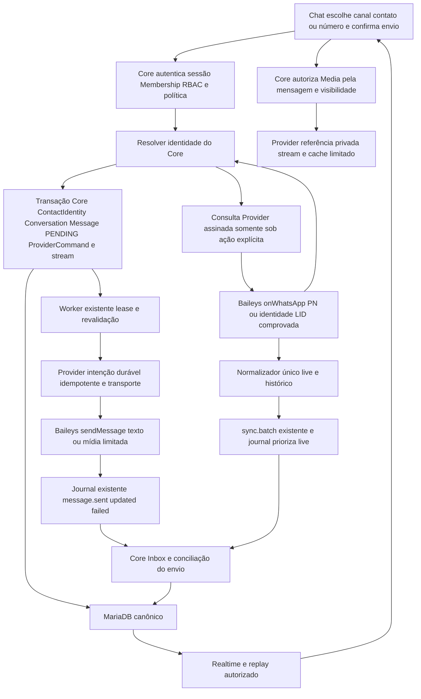

# Consolidação WappHub — proposta A2 para aprovação única

Estado: proposta aprovada tecnicamente para B1–B4 na revisão do PR25; implementação e evidências no progresso canônico. Base Core/Provider `766ff09`, Chat funcional `f13752f`. Diagnóstico e evidências: [AUDIT](WHATSAPP_WEB_CONSOLIDATION_AUDIT.md). Andamento exclusivo: [PROGRESS](WHATSAPP_WEB_CONSOLIDATION_PROGRESS.md).

## 1. Decisão recomendada

Manter Core, Worker, Provider independente e Chat. Consolidar as políticas repetidas no Core e conectar resolução de destinatário, envio e mídia aos contratos/outbox/journal existentes. Corrigir primeiro a retomada segura e as lacunas do bootstrap remoto antes de qualquer publicação. Não criar novo banco, fila Redis, microserviço ou backend de conversas.

A aprovação desta proposta inicia B1–B4 e a preparação documental de B5, sem microaprovações. Esta execução A não autoriza deploy. Publicação futura depende de autorização explícita aplicável; a aprovação pode incluir essa autorização expressamente. Envio real, pareamento de conta de teste, reupload remoto de mídia e recuperação histórica real continuam sujeitos às autorizações da operação/conexão. Testes automatizados usam exclusivamente dados sintéticos.

Documentos antigos SCOPE/MILESTONES/AGENTS excluem vídeo do MVP, enquanto o contrato de consolidação requer sua capacidade. Recomenda-se incluir imagem/áudio/voz/vídeo nesta consolidação mediante esta aprovação explícita e registrar a extensão de escopo em ADR/documentos antes de implementar vídeo. Não antecipar chamadas, grupos, Status, campanhas, IA, Platform ou faturamento.

## 2. Responsabilidades e fluxo final

Core decide autor, contato, conversa, capacidades efetivas, estado e segurança. Provider apenas resolve/transmite/normaliza e aplica autenticação/escopo/limites técnicos. Browser nunca fornece identidade de tenant confiável ou material criptográfico. Core continua servindo os mesmos contratos para futuro Android.

## 3. Matriz de reaproveitamento e mudança mínima

| Existente | Lacuna | Alteração mínima | Teste de aceite | Risco/rollback |
| --- | --- | --- | --- | --- |
| Provider Sessions/geração/vault AES-GCM | lifetime attempts5 impede restart saudável | contador aditivo de falhas por episódio; attempts anterior fica evidência; sucesso autenticado estável encerra episódio, revogação/QR continuam bloqueados | vault fixture equivalente ao atual com attempts5/auth/CONNECTED recupera; três starts/processo e cinco falhas/episódio;401/440 param sem limpar auth | compatibilidade de leitura antiga; voltar só a código que compreenda novos campos sem restaurar Signal |
| PR23 pending historyImports/decoder limitado | captura constante após RECENT100; ausência de retry agendado e parcial/truncamento | predicado dinâmico único + cursor/digest/orçamento por referência; Worker agenda somente processamento local seguro | bootstrap termina, append recente e notify continuam; restart com pending; falso self/correlação; vazios/truncamento; sem fetch nova | referência antiga perdida não reaparece; desativar captura inicial preservando live |
| Grant/ProviderCommand/HistoryImporter CP47 | reconciliação15s em pausa inútil;20 confundido com limite do bootstrap | lease renovada só ativo; nextEligibleAt e motivo de pausa; retry local bounded por versão de política, nunca replenishment | milhares de ticks sem progresso não geram milhares de comandos;5min/backoff e quota respeitados; request count constante após resultado incerto | grant existente20 mantido; flags/pause impedem novos dispatches |
| WebSync/ContactIdentity/MessageIngestion | duas políticas de identidade/persistência clássica | extrair resolvedor Core usado por ingress e abertura; converter evento clássico para estrutura canônica, mantendo Inbox/hash/evento original | replay dos envelopes antigos, Demo, PN/LID conflitante e nome manual sem alteração | migrar comportamento antes de remover código, rollout aditivo |
| Channel/Conversation únicas por org/canal/identidade | abertura atual só interna | estender createConversation com canal/target e resolução explícita; criação externa vinculada apenas após destino válido, sem mensagem implícita | conhecido/novo/inválido/inexistente/ambíguo/cross-tenant/concorrência | canal interno legado continua default; novo fluxo pode ser desligado sem apagar conversas |
| Chat.send/clientMessageId/ProviderCommand | chamada externa não possui workflow persistente Web | transação MessagePENDING+comando existente; Worker e port ampliados; registro idempotente Provider antes da rede | crash antes/depois de envio/commit/ACK; recibo antecipado; repeatHTTP igual/alterado; nenhuma transmissão incerta repetida | pausar dispatch e escoar/conciliar pendentes antes de Worker antigo |
| Contrato message.sent/updated/failed | Core rejeita autoria WAPPHUB externa e não há resultado incerto persistido | aceitar correlação de envio apenas com intenção Core; campo deliveryOutcome aditivo, manter enum público compatível | echo dispositivo preserva atendente real; comando forjado não inventa autoria; UNKNOWN impede retry | cliente antigo desconhece outcome: feature flag mantém envio Web fechado até Chat compatível |
| capabilitiesSchema/registry inexistente | contentTypes confunde metadata/in/out | registry mínimo Demo/Web; projeção efetiva por ação/conteúdo e estado com motivos | flagfalse, conexão indisponível, usuário sem direito e tipo não suportado falham no Core | campo aditivo; manter booleanos legados derivados |
| Media metadata canônica | sem referência para bytes, Media/model/rotas/player ausentes | referência mínima criptografada no Provider, Media scoped Core e MediaStore de cache privado; stream autenticado por Core | tamanho real/MIME/hash/tenant/LIMITED/NONE/expiração/range/upload abortado; não baixar em massa | mídia fica unavailable quando cache expira; nenhuma restauração de credenciais |
| providerMetadata remoto e archive interno | patch esparso substitui JSON | merge somente campos presentes, provenance/observedAt; remoteArchived separado no DTO | update de unread mantém archived remoto; metadado remoto não arquiva/reabre atendimento | campos aditivos, status interno preservado |
| Chat ContactBrowser/compositor/scroll/realtime | nova conversa externa/media/UNKNOWN ausentes, refresh amplo contacts.updated | ampliar componentes existentes; coalescer invalidação por conversa; preservar ancoragem e cache scoped | tenant muda durante resolve/upload/send; ordem/scroll sem saltos, sem falso unread; Demo | novo controle indisponível se capability ausente; sem design system paralelo |

## 4. Capabilities: realidade atual e alvo

Capacidade do SDK não significa disponibilidade do produto. A projeção efetiva será `permission + política técnica/quotas + capability + canal + saúde + regra da conversa`. Catálogo M2.1 tem recursos base/permissões; não é resolvedor de assinaturas. Esta consolidação não implementa billing/entitlements comerciais. Reservar o hook de política no Core e declarar recursos base/configuração técnica; um recurso comercial condicionado a entitlement desconhecido fica bloqueado, sem inferência por plano.

| Operação | Demo atual/alvo | WhatsApp Web atual | Alvo Web aprovado | Meta futuro |
| --- | --- | --- | --- | --- |
| Texto receber/responder | operacional, simulação local | receive+saída celular; Chat send bloqueado | receber/responder pelo mesmo domínio, autoria real | indisponível até adapter implementado |
| Nova conversa existente | interna e Demo com identidades do simulador | nenhuma abertura externa manual | contato com identidade verificada no canal ou resolução explícita | indefinido, requer regras Cloud próprias |
| Número não cadastrado | não consultar rede; não inventar WhatsApp no Demo | onWhatsApp somente no SDK | PN internacional+consulta explícita+persistência correta+envio confirmado | indisponível; não simular suporte |
| Imagem/áudio/voz/vídeo | sem capacidade; continuar desabilitado | metadados de entrada, sem bytes | receber/view/play sob demanda e enviar conforme formatos validados | indisponível |
| Documentos | indisponível | metadata recebido | preservar metadata; download somente de tipos seguros pela mesma política; envio documento não é requisito desta proposta | indisponível |
| Recibos | locais, existentes | SDK/celular reconciliados | status externo observado; UNKNOWN visível | indisponível |
| Histórico | paginação interna | piloto adicional20; bootstrap PR23 não publicado | bootstrap entregue separado do piloto; backfill por grant/âncoras/orçamento | sem promessas de importação |
| Arquivamento | interno | interno + remoto em metadata | manter independência de ambos | indisponível |
| Grupos/Status/chamadas/exclusão | não | não | não | fora de escopo |

O registry não conterá adapter Meta fictício. Não ampliar cardinalidade Channel para vários números por provider agora; o schema atual `unique(organizationId,provider)` é uma conexão Web por org, a manter nesta entrega. Multi-canal futuro exige decisão/migração própria.

## 5. Regras de destinatário e abertura

1. Chat reutiliza ContactBrowser e adiciona canal efetivo e entrada de número com DDI explícito. Só seleção/digitação não chama WhatsApp, não cria conversa e não envia. A ação de validar/abrir/enviar é explícita.
2. Core valida sessão/Membership/organization do contexto, `contacts.read`, `conversations.read/create`, `messages.send` para envio; criação de novo contato exige também `contacts.write`. Reutilização não revela conversa de outro atendente sem supervisão. Canal conectado/saudável e quotas são confirmados antes e novamente após consulta remota.
3. Normalizar número internacional `+`/DDI e dígitos, até15 dígitos; não assumir +55 nem converter LID em telefone. Validação sintática e resultado `onWhatsApp` são etapas distintas. Consultar PN novo/sem comprovação atual somente sob ação explícita; timeout/ausência ambígua resulta UNKNOWN, não inexistência definitiva nem envio.
4. Identidade LID conhecida só é usada se vínculo comprovado no canal; onWhatsApp não recebe LID. Identidade PN validada e aliases comprovados alimentam ContactIdentity único por org/canal/externalId. Nome nunca serve de chave. Contatos manuais existentes têm prioridade quando escolhidos explicitamente; conflitos entre registros já vinculados bloqueiam sem mesclar/apagar.
5. Resolução válida pode abrir/reutilizar conversa externa sem enviar mediante confirmação de abertura. Para número novo, a confirmação de primeira mensagem pode criar Contact/Conversation/Message/ProviderCommand na mesma transação após validação. Rota interna antiga continua sem canal e sem efeito externo.
6. Arquivada internamente exige reabertura autorizada, nunca por efeito do WhatsApp. Reuso tem filtro de visibilidade; se identidade já possui conversa inacessível, informar bloqueio seguro em vez de criar outra que contorne histórico.
7. Usar chave de intenção antes da existência da conversa (`commandId`/clientMessageId+org+canal+destino/hash), persistida no ProviderCommand existente; índice unique já existente impede duplo clique e race entre resolução e transação. Resultado da intenção guarda vínculo interno, sem cópia de corpo no payload de comando SQL. Mesma chave/outro autor ou conteúdo resulta409.

## 6. Envio, autoria e resultado incerto

O fluxo Web grava Message com senderUserId autenticado, body/transmittedBody originais e comando payload de referência/hash em uma transação. HTTP retorna intenção aceita/PENDING; o Worker executa fora da transação e fora do lock da Organization. Demo mantém adaptador local determinístico e API compatível.

Provider recebe comando HMAC e scope já resolvido pelo Core; persiste digest/commandId/providerMessageId gerado antes de chamar sendMessage. Adicionar métodos pequenos `resolveRecipient`, `sendText`, `sendMedia` ao port/transport atual. Sem chamada de saída durante startup/GET/montagem da UI. O registro de envio idempotente deve permanecer até Core confirmar reconciliação mais a janela de retry; o ring atual de256 lifecycle commands não é garantia suficiente para retry de mensagens antigas. Guardar estado mínimo no mesmo Vault com quota/limpeza explícita e, se pressão impedir persistência, recusar antes da rede.

| Situação | Estado observável | Ação segura |
| --- | --- | --- |
| Intenção aceita, ainda não transmitida | PENDING/QUEUED | Worker revalida autorização/canal; despacho limitado |
| Recusa de destino/formato ou falha provada antes da transmissão | FAILED + NOT_SENT | retry explícito com mesma intenção conforme causa e autorização |
| Timeout após chamada SDK ou crash durante transmissão | UNKNOWN | conservar identidade/intent; consultar recibo/echo/registro, não retransmitir automaticamente |
| SDK retornou ID | transmissão identificada; sem inferir DELIVERED | consolidar ID e evidência; SENT apenas evidência definida/ACK do servidor |
| SERVER_ACK/DELIVERY_ACK/READ/PLAYED | SENT/DELIVERED/READ | monotônico, sem deduzir estados ausentes |

Propõe-se `Message.deliveryOutcome` nullable/compatível para NOT_SENT/UNKNOWN, preservando enum de status existente e DTO antigo; dados antigos não recebem uma conclusão inventada. Recibo journal pode chegar antes da gravação do retorno HTTP e deve reconciliar pela intenção com provider ID persistido. Mensagem ecoada `fromMe` preserva autor interno somente se corresponde à intenção Core; o resto permanece DEVICE.

Core aceita `message.sent/failed/updated` de envio apenas quando correlation/commandId e Message/canal/destino/hash correspondem ao registro validado; senderUserId vem do SQL. Não confiar em `sender.origin=WAPPHUB` desacompanhado de intenção. Preservar dedup SQL, Inbox/dataHash, lease e commit-before-ack. `messageStatus` manual permanece proibido para mensagens externas. Pausa histórica não pausa live nem respostas do atendente.

Worker revalida autor/Membership/permissões/contexto administrativo e revoga intent ainda não transmitida conforme política de sessão e segurança existente; fechamento da aba não cancela intenção aceita. Sem bypass da revogação server-side. Falha SQL antes de persistir impede envio; falha depois da transmissão vira conciliação, nunca nova tentativa cega. Redis perdido não altera resultado transmitido; replay SQL recupera UI.

## 7. Histórico inicial, adicional e limites

Reutilizar historyImports para referências bootstrap e historyOperation para ON_DEMAND autorizado, alimentando o mesmo decoder/normalizador/journal. Origens possuem lifecycle/autorização diferentes; não são duas implementações de mensagens. Extrair helpers de seleção/admissão/checkpoint e política de pausa, preservando distinction de grant e captura inicial.

| Limite | Código publicado | Main remoto PR23 | Política proposta |
| --- | --- | --- | --- |
| Envelope/lote journal | 64KiB;20itens/48.000bytes | igual | manter por lote |
| Staging histórico/live | histórico1500itens/1,5MiB; live teto2000/2MiB sobre staging compartilhado | igual | manter reserva/prioridade live e cursor quando backpressure |
| ON_DEMAND por operação | piloto20; máximo500contatos/500conversas/1000mensagens;30dias;16pedidos | igual | autorização existente20 não aumenta; ampliar somente configuração/autorização futura registrada |
| Decoder por arquivo | 1MiB comprimido/8MiB descomprimido | 4MiB/16MiB | usar limites PR23 após testes/medição e correções; não eliminar proteção |
| Ciclo de arquivos | até16referências/32MiB decodificados; spool2MiB | igual; pending referenciado até4MiB | explicitar orçamento cumulativo e motivo parcial, não limite de batch |
| Bootstrap admitido | desativado na conta existente/imagem |500/500/1000 cumulativos no sync; janela30dias | ciclo inicial500/500/1000/30dias, não piloto20; cursor nos dados entregues; esgotado mostra parcial, expansão somente política configurada |
| Requests/cooldown |30s entre pedidos,5min/conversa,16/op;45slease;60stimeout | igual | manter limites; lease15s só ativo; pausas com nextEligibleAt e backoff, sem loop |

Os arquivos entregues pelo protocolo têm budgets de bytes/itens/tenant; dados excluídos por quota/janela/corte devem ser contados como indisponíveis no orçamento, sem declarar história completa. Um limite por lote não deve apagar restante de referência já entregue: selecionar por cursor, persistir itens e avançar somente após staging durável. Nunca manter Buffer de todas as conversas/mídias nem cortar1.000 e declarar captura integral. Para arquivo que excede limite de segurança, rejeitar com diagnóstico parcial; não alocar para descobrir quantos objetos contém.

Separar contadores de trabalho/admissão, objetos distintos e registros novos efetivamente persistidos. Atualizações repetidas do mesmo contato/conversa não representam novos objetos; replays conhecidos não devem consumir quota de identidades novamente. Mensagens já existentes no Core continuam limitadas pelo orçamento de processamento, sem serem anunciadas como recuperadas e sem ampliar automaticamente o número de solicitações para compensar duplicatas. Preservar manifest e contadores de naturezas diferentes no diagnóstico.

Captura inicial ocorre somente no primeiro vínculo autorizado quando WhatsApp entrega notificações aceitas; conta existente não recebe syncFullHistory/re-pareamento para forçar bootstrap. Retomada de pending comprovado é processamento de referência já recebida; re-download limitado dessa referência não equivale a nova fetchMessageHistory, mas é I/O remoto e exige autorização válida/limites. Referência ausente não permite reconstrução presumida.

Depois de RECENT100, esgotamento ou inatividade limitada, recalcular captura ativa; novos notify e append recentes seguem live. Terminar sem evidência total produz parcial/aguardando, nunca completo universal. Request incerto permanece parado; vazio só significa sem novos dados naquele pedido. Retry de referência com byte-limit requer nova política compatível e contador limitado; sem mudança de política, pausa por tamanho não deve gastar decode nem lease15s indefinidamente.

No Worker manter máx2 conexões/tick e budget de trabalho existente; saída interativa/recebimento live têm prioridade, backfill reduz se backlog>100/RSS>384MiB ou falha SQL/autenticação. Não iniciar novo orçamento no fim do anterior. Na conta atual, referência retida existe, mas esta proposta não a executa nem promete que sua recuperação terá mensagens.

## 8. Mídia sob demanda e privacidade

É necessário persistir **agora na implementação futura**, para novas mensagens recebidas, uma referência mínima criptografada no Provider (`mediaId`, key/id, directPath/mediaKey/hash e tipo somente necessários). Core conserva metadata/vínculo, nunca chaves. Mensagens antigas cujas referências já foram descartadas devem mostrar indisponibilidade; não inventar recuperação por mediaId/hash.

Recomenda-se MediaStore pequeno e cache privado de filesystem criptografado, sem novo serviço storage no homelab. Core é autoridade de Media e sua relação tenant/Conversation/Message; Provider possui referência e transporte. Formalizar em ADR a implementação local temporária da abstração de storage: permitir backend object storage no futuro sem alterar Chat/domínio.

- Consultar bytes somente ao abrir/baixar/visualizar mídia autorizada. Core valida messages.read e FULL/LIMITED/NONE inclusive importação tardia, em cada pedido e troca de tenant; browser recebe stream autenticado do Core, sem acesso direto ao Provider, URL remota ou chaves. GET pode usar cache; operação que inicia reupload remoto é POST com CSRF e confirmação aplicável, nunca retry oculto de GET.
- Implementar método de stream separado no cliente interno. O requestJSON atual tem timeout7s/cap256KiB e não serve para mídia. Assinatura cobre método/caminho/scope/handle/hash e parâmetros de Range, sem tentar serializar binários em JSON. Upload Core mede/hash/inspeciona em stream e só finaliza arquivo completo antes do dispatch; nenhum SDK raw no contrato `sync.batch`.
- Não aceitar URLs arbitrárias do Chat; permitir somente handles internos e hosts/path de mídia verificados do protocolo, com redirects/DNS/IP privados bloqueados. MIME por bytes/container além do declarado, tamanho contado mesmo sem Content-Length, checksum quando conhecido. Não servir arquivos executáveis/HTML/SVG como conteúdo ativo. Filename sanitizado e Content-Disposition seguro.
- Proposta inicial: imagens8MiB, áudio/voz16MiB, vídeo25MiB, sempre≤MAX_MEDIA_BYTES25MiB do contrato. JPEG/PNG/WebP, formatos de áudio e vídeo realmente validados no SDK/browser (por exemplo MP4 compatível); codec/container incompatível deve produzir erro claro. Gravação via MediaRecorder depende de formato aceito; conversão Opus/container, se necessária, é subfunção limitada e testada, sem declarar conversão inexistente. Dependências de parser/codec devem ser mínimas e revisadas.
- Uma transferência global simultânea inicialmente; cache256MiB/conexão,512MiB total, TTL24h, scratch≤128MiB por transferência, reserva de disco/cleanup/aborto. São parâmetros técnicos propostos, a medir com fixtures antes da ativação; não limites comerciais aprovados em produção. Pausar em pressão e priorizar live.
- SDK usa tmpdir para criptografado e eventualmente original; tmpfs16MiB atual precisa adequação controlada. Evitar original persistido quando metadata/thumbnail já foram calculados com bounds. Dados originais temporários, quando inevitáveis, permanecem em tmpfs privado dimensionado, sem ocupar vault Signal, com remoção ao abortar/terminar/reiniciar. Cache em disco é criptografado; validade/hash completo antes de servir Range a partir dele.
- downloadMediaMessage stream/updateMediaMessage são capacidades do SDK, não garantia de disponibilidade permanente. Reupload pode depender do dispositivo e falhar; não desencadear automaticamente por expiração. UI mostra mídia indisponível/expirada e opção autorizada separada quando aplicável.
- Reutilizar compositor/bubble existentes com attachment preview, áudio/player, vídeo com controles nativos e imagem ampliada. URLs locais de preview revogadas na troca de tenant/unmount; upload cancelado não vira mensagem enviada. Sem galeria global, download em massa ou processamento de todas as mídias de conversas.

## 9. Contratos, schema e componentes propostos

Mudanças públicas aditivas, sem renomear rotas existentes:

| Contrato | Alteração proposta |
| --- | --- |
| GET /api/v1/providers | capability efetiva por ação/tipo/direção, motivos de indisponibilidade; manter campos antigos |
| POST /api/v1/conversations | canal/target verificado opcional; contrato interno contactId/reuseExisting preservado; sem envio implícito |
| POST /api/v1/conversations/:id/messages | conteúdo normalizado texto/mediaId + clientMessageId; resposta de intenção; body texto antigo preservado |
| POST /api/v1/channels/:id/recipients/resolve | validar PN/identidade sob ação explícita e RBAC/CSRF; resultado válido/inexistente/inconclusivo, handle com scope/TTL e revalidação; não criar conversa |
| POST /api/v1/channels/:id/messages | primeira mensagem para destino validado sem conversationId prévio; mesma aplicação/send/outbox, atomicidade de criação; não segunda implementação de envio |
| POST /api/v1/media/uploads e finalização | upload streaming autorizado, inspeção/hash/tamanho/TTL, vínculo de intent; finalização só após completo |
| GET /api/v1/messages/:id/media | autorização da própria mensagem, stream/range/cache, sem chave/URL externa |
| POST /api/v1/messages/:id/media/recovery | somente caso reupload esteja suportado/autorizado; ação explícita e auditada |
| Interno /internal/v1/.../connections/:id | acrescentar resolve/send/stream e retry local ao port existente; HMAC/nonce/escopo em todos |
| sync.batch / message.sent/updated/failed / media.updated | preservar envelopecanônico v1; eventos de saída correlacionados à intenção; media.updated apenas metadata validada |

Antes de novas rotas de intent/resolve, revalidar se os schemas existentes acomodam a operação por extensão; paths acima são proposta revisável, não APIs existentes. Core controla UUID/scope/actor. Não adicionar Organization fornecida pelo cliente no payload como autoridade.

Schema mínimo: Message.deliveryOutcome nullable; Media com FK composta org/conversa/mensagem/canal, metadata/checksum/status/handle/expiry, sem bytes/chaves; payload ProviderCommand discriminado por ação com referência de Message/Media e digest. Índices/relacionamentos necessários em migration pequena, aditiva e validada isoladamente. Destinatário/resolve handle podem reutilizar ProviderCommand.payload com TTL e intenção; não criar tabela se o contrato atual satisfizer idempotência/consulta. Provider adiciona campos opcionais de intent/media-reference e counters ao vaultv1 com leitura retrocompatível, quotas e testes de migração de fixtures.

Componentes: registry/availability pequeno Core, resolvedor de identidade compartilhado, port de stream no cliente interno, MediaStore local. Ampliar WebProviderWorker e adaptador Baileys existente; não novo daemon. Chat amplia NewConversation/ContactBrowser/ComposerTools/Conversations e contratos existentes; reutiliza tokens, confirmação e drawer de diagnósticos. Estado UNKNOWN e razões de pausa vêm do Core. Arquivamento remoto somente discreto no contexto, sem mudar status operacional. Não há controle para desligar sync live de conexão ativa.

## 10. Sequência interna e critérios de aceite

| Gate | Trabalho após aprovação | Aceite reproduzível |
| --- | --- | --- |
| B1 | corrigir transição bootstrap/fixtures; orçamento de reconexão e retry local; preservar lifecycle |78testes atuais passam sem relaxar schema; probes viram regressões; vault attempts5 recuperável sem QR; bursts/restart/partial explicáveis |
| B2 | resolvedor único, capabilities, patches de metadata, cursores/admissão por referência, coordenação sem churn | tenant/fencing/hash/commit-before-ack; quotas/lote distintos; no-progress sem loop; PN/LID/nomes/admin/autoria/visibilidade preservados |
| B3 | intenção de envio/outbox/recibos/nova conversa; referência/cache/media e UI existente | responder e iniciar por contato ou número novo; texto/imagem/áudio/voz/vídeo suportados; estados reais; sem mocks em produto, sem requisição real em testes |
| B4 | contratos/schema/OpenAPI, testes integrados/segurança/recursos/regressão | Core/Provider/Chat integral, lint/type/build/audit/Prisma/drift/CI; testes falha SQL/Redis e carga sintética limitada sem impacto live |
| B5 | publicação somente autorizada, backup SQL+vault/restore isolado, imagens rollback, smokes | nenhum QR/logout/resetSignal; guard atual resolvido com testes e plano antes de restart; ACK/pendentes compatíveis; nenhuma requisição real nova por deploy |
| B6 | roteiro de usuário e relatório verificável | AGUARDANDO_HOMOLOGACAO, sem declarar aceite antes do feedback humano |

Matriz mínima de integração (cada cenário deve atravessar as camadas relevantes, além de unidades):

- contato existente com PN/LID e número novo válido: Chat→Core→Worker→Provider sintético→journal→SQL→realtime; assignee/autoria/IDs/idempotência preservados;
- número inválido/inexistente/inconclusivo, DDI não brasileiro, LID sem equivalência, contatos duplicados ambíguos: nenhum envio/contato fantasma, mensagem de erro segura;
- usuário sem direito, CSRF/Origin/sessão revogada, org/canal/Media estrangeiros, troca de org durante consulta/upload/send: nenhuma leitura/escrita/transmissão cruzada;
- concurrent duplicate intent, replay alterado, crash antes/depois de dispatch, resultado UNKNOWN, receipt antecipado/duplicado/fora de ordem: sem retransmissão incerta e sem autoria fictícia;
- SQL rollback e Redis indisponível, replays e Core reiniciado: intenção/Inbox/stream consistentes, receipt não ACK antes do commit;
- QR inicial sintético, vault vinculado sem bootstrap, cutoff sem RECENT100, chunk excessivo, referências pendentes, timeout, pause/revoke/quota/no progress/cooldown: sem novo QR/fetch implícita, live prioritário;
- mídia grande/header falso/URL maliciosa/hash errado/cacheexpirado/range/aborto, Full/Limited/None e importação tardia: stream limitado e autenticado, sem segredos/bytes em logs ou eventos;
- Demo texto/simulador/criação interna permanecem compatíveis; metadata-only, dados administrativos e14falhas legadas preservados;
- coalescing de Inbox e mensagens antigas, paginação/scroll/read anchor, preview seguro, persistência após refresh; componentes jsdom/teclado/abort sem browser no servidor.

Aceite humano após publicação autorizada: conectar ou preservar conta conforme ação expressa, responder/iniciar por contato e número, receber texto e testar mídia autorizada, conferir recibos/autoria, live durante backfill, refresh/pausa/tenant, desktop/notebook/tablet/mobile no notebook. Sem teste gráfico no homelab. Sondas sintéticas não comprovam entrega real, disponibilidade histórica ou layout real.

## 11. Alternativas rejeitadas, dependências e rollback

Rejeitadas: segunda fila/banco de mensagens; SDK no Core/Chat; frontend chamar Provider; apagar/padronizar sessão à mão; usar novo pareamento/resyncAppState para obter histórico; Promise HTTP/SENT como DELIVERED; retry cego UNKNOWN; download integral de mídia; upgrade de Baileys por suposição; provider registry genérico para integrações hipotéticas; fundir contas por nome ou LID inferido; aumentar budgets sucessivamente sem autorização; remover caminho legado sem provar equivalência.

Dependências: corrigir CI Provider; aprovar extensão de vídeo/documentos de scope; definir política técnica/quotas; escolher parsers/codec/cache com limites e revisão; resolver guard de reconexão antes de restart; publicar Core/Provider/Chat compatíveis; política de retenção de intents/references sem duplicar conteúdo pessoal desnecessário. Não há garantia de obter o arquivo remoto retido ou de recuperar mensagens anteriores ao vínculo.

Rollback futuro: flags novas de saída/mídia fechadas por padrão e habilitação por conexão; preservar sync live. Parar novos dispatches, drenar/conciliar intents e receipts; UNKNOWN não se retransmite. Migrações nullable/aditivas permanecem; não apagar mensagens nem restaurar SQL/vault antigo sobre produção ativa. Retornar imagens compatíveis após verificar pendências e formato do Vault; versão antiga sem suporte à intenção nova não pode consumir jobs novos. Cache temporário pode expirar/ser removido por política sem tocar sessão. Backups/restauração isolada são gate futuro, não executados nesta fase.

Riscos materiais para aprovação: não oficial/RC14 e protocolo variável; guard atual esgotado; limites e cache não garantem todo histórico/mídia; autorização/visibilidade em streams; correlação outbound/echo e resultado incerto; scratch16MiB incompatível com mídia maior; aumento de trabalho SQL/fsync/codec em host com swap. Mitigações estão vinculadas aos testes/gates acima. Nenhuma mitigação funcional foi aplicada nesta auditoria.
